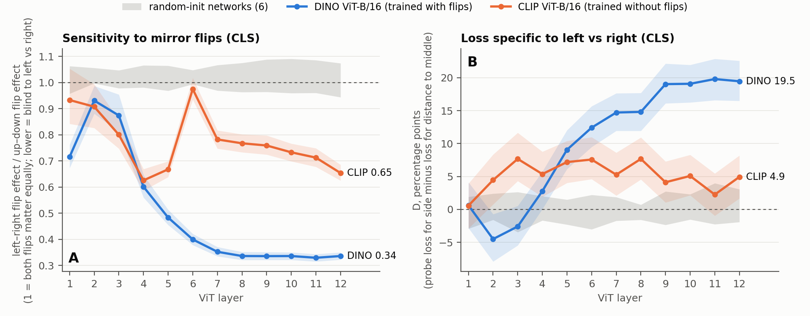

# Mirror Invariance and Attribute Binding in Vision Transformers

**Status:** work in progress (independent research, since September 2026; dated log in [`LOG.md`](LOG.md)). A preprint for arXiv (cs.CV) is in preparation.
**Author:** Yernazar Gabdrakhman

## Question

To understand a scene, a vision model has to know *which feature belongs to which object*. The images "red square + blue circle" and "blue square + red circle" contain the same set of features and differ only in this **binding**. A model that keeps only a "bag of features" cannot tell them apart.

This project asks whether Vision Transformers (ViTs) store attribute binding, in which layers it is kept or lost, and what makes a model lose it.

## Method

- **Stimuli.** 2,000 synthetic 224×224 scenes with 2–4 simple shapes in six colors of equal brightness (`generate_v2.py`). Every scene has two **twins** (same shape and size, different colors) and three versions:
  - `S`: the original scene;
  - `Sp`: the twins swap colors, so the bag of features is identical down to the pixel and only binding changes;
  - `Sr`: a control in which the twins are recolored with two new colors.
- **Probes.** At every layer, a linear probe (logistic regression; ridge as a robustness check; cross-validated by scene) predicts the color of the *left* or *upper* twin. It reads from the CLS token, from untouched objects, or from background patches at least 3 patches away from both twins. A bag-of-features representation scores **exactly 50%** by construction.
- **Controls.** Layer 0 (must be exactly 50%), three randomly initialized networks per architecture, and a positive control (the twin's own patches, ~100%). All intervals are 95% bootstrap CIs over scenes.
- **Mirror test.** For scenes made only of mirror-symmetric shapes, we measure how much a left–right flip changes the representation compared with an up–down flip (`flip_test.py`). A value of 1 means both flips matter equally; lower means the model is blind to left vs. right.
- **Rules and predictions written down before each run.** For each experiment, the decision rule (and my own prediction) was recorded in the project notebook before the run; they are not externally timestamped. English versions and the scored predictions (34 hits out of 79 resolved so far) are in [`PREDICTIONS_AND_RULES.md`](PREDICTIONS_AND_RULES.md). Since 6 November 2026, the design, rule and prediction are also registered on OSF before the run ([osf.io/us5zv](https://osf.io/us5zv), [osf.io/6uves](https://osf.io/6uves), [osf.io/23wjy](https://osf.io/23wjy), [osf.io/j2g74](https://osf.io/j2g74), [osf.io/5hn9u](https://osf.io/5hn9u), [osf.io/3f9tz](https://osf.io/3f9tz), [osf.io/8s4gm](https://osf.io/8s4gm), [osf.io/npvs5](https://osf.io/npvs5), [osf.io/xyedr](https://osf.io/xyedr), [osf.io/dprnk](https://osf.io/dprnk), [osf.io/gdnvb](https://osf.io/gdnvb), [osf.io/8nxg7](https://osf.io/8nxg7), [osf.io/7tsgq](https://osf.io/7tsgq), [osf.io/syevu](https://osf.io/syevu), [osf.io/ducms](https://osf.io/ducms) and [osf.io/pxaz4](https://osf.io/pxaz4), under embargo until the preprint, at the latest 31 March 2027).

Models: DINO ViT-B/16, OpenAI CLIP ViT-B/16, MAE ViT-H/14, I-JEPA ViT-H/14 (target encoder), DINOv2 ViT-B/14 with registers, DeiT III ViT-B/16 (supervised). Finding 14 uses 24 pretrained ViTs from 12 families: four of the six above (DINO, CLIP, DINOv2 and DeiT III) and 20 others (listed in [`PREDICTIONS_AND_RULES.md`](PREDICTIONS_AND_RULES.md)). Finding 15 uses real photographs: aerial images (UC Merced Land Use) and COCO val2017. Finding 16 uses DINO, DeiT III and OpenAI CLIP (ViT-B/16). Finding 19 uses the 24 networks of finding 14. Finding 20 trains ViT-Tiny from scratch on ImageNet-100 (the 100 classes of Tian, Krishnan and Isola, 2019).

## Results so far

| | DINO | CLIP | MAE | I-JEPA | DINOv2 | DeiT III |
|---|---|---|---|---|---|---|
| Mirror sensitivity, last layer (CLS / patch mean; random ≈ 1) | 0.34 / 0.28 | 0.65 / 0.61 | 0.67 / 0.63 | — / 0.40 | 0.56 / 0.51 | 0.41 / 0.38 |
| Binding gap "upper − left", **far background**, last layer (pp) | 18.6 | 9.0 | 10.1 | 11.4 | 10.2 | 17.2 |
| Binding gap "upper − left", **CLS**, last layer (pp) | 20.4 | 9.3 | 6.8 | no CLS | 11.5 | 19.7 |

Last layer: L12 for DINO, CLIP, DINOv2 and DeiT III (ViT-B), L32 for MAE and I-JEPA (ViT-H/14). DINO's CLS gap is exactly 20.35 pp (83.85 − 63.50); the probe-robustness log prints it as 20.3. Every number names the token group it comes from; the source CSVs and logs are in [`results/`](results/).

1. **Binding is learned and readable.** In DINO, the left twin's color is decoded from the CLS token with up to 78.2% accuracy (layer 3); the upper twin's with 83.9% at layer 12. From the far background (the readout used by all later pre-registered rules): 73.0% (layer 3) and 83.5% (layer 12). Random networks stay at 49–52%.
2. **Left–right binding fades where mirror invariance appears.** From layer 4 on, DINO's left–right binding drops (to 63.5% at layer 12 from CLS; 64.9% from the far background) while up–down binding stays. Over the same layers DINO's sensitivity to left–right mirroring falls (CLS: 0.87 at layer 3, 0.60 at layer 4, 0.34 [0.32, 0.35] at layer 12).
3. **DINO "folds" the image.** It loses *which side* an object is on but keeps *how far* it is from the vertical midline (rule fixed before the run; from the CLS token at layer 12, D = 19.5 [16.5, 22.6] for DINO vs. 4.9 [1.7, 8.2] for CLIP; from the far background, 16.0 [12.6, 19.2] vs. −0.2 [−3.4, 3.0]). See Figure 1.
4. **In these two models, flip augmentation was not needed for mirror blindness.** In a comparison with a rule fixed before the run (same size and training data), I-JEPA, which never saw flipped images, is *more* mirror-blind than MAE, which did: Δ = −0.22 [−0.30, −0.15] (patch mean, last layer). MAE is itself partly mirror-blind (0.63, patch mean; random networks ≈ 1), so the pair does not show that flips are insufficient (an earlier version of this finding said "neither necessary nor sufficient"; corrected on 12 Nov). MAE and I-JEPA also differ in their training objective, so this is not a clean test of a single factor; the objective and the statistics of natural images remain candidates.
5. **The binding gap does not separate MAE from I-JEPA.** On the far background at the last layer the gap is 10.1 [8.5, 11.6] pp for MAE and 11.4 [9.9, 13.0] pp for I-JEPA; Δ = 1.3 [−0.6, 3.2] pp. By a rule fixed before the run the verdict is "does not discriminate": the interval includes 0, so the data neither show nor exclude a difference. I-JEPA is much more mirror-blind than MAE (0.40 vs. 0.63), yet does not clearly lose more left–right binding. So "more mirror-blind → larger binding gap" is not confirmed in this pair; at that point the link rested on DINO and CLIP only (findings 12 and 14 test it across more networks). Per-layer differences are uneven (see `results/probe_big_compare_log.txt`).

6. **First causal test: in DINO, both attention and MLP in blocks 4–12 are needed for the loss of left–right binding.** Registered on OSF before the run ([osf.io/us5zv](https://osf.io/us5zv)). The output of all attention (or all MLP) sublayers in blocks 4–12 is replaced by its mean over the images, separately for each token position (mean-ablation), and the probes are retrained at layer 12 (far background, 97.5% CIs). With attention ablated, "left" rises by +4.5 [+2.7, +6.3] pp while "upper" falls by 8.2 [6.8, 9.8] pp; with the MLP ablated, "left" rises by +8.5 [+6.9, +10.1] pp and "upper" by +3.1 [+1.8, +4.4] pp. By the rule both parts "erase" → verdict "C". No single sublayer does so on its own (18 sublayers, 99.72% CIs), so the loss is spread across blocks. *Not part of the rule:* ablating attention also restores mirror sensitivity (CLS 0.34 → 0.82), while ablating the MLP restores "left" but leaves the model almost as mirror-blind (0.40). So the loss of left–right binding can be separated from mirror blindness: mirror blindness is not the only cause. Caveats: one model; mean-ablation puts the network outside its training distribution; it shows that a part is needed, not how it erases; ablating attention in nine blocks also cuts each token off from new information from other tokens after layer 3, which is why "upper" serves as a control.

7. **The same causal test on CLIP: on the far-background readout, only attention is needed for the loss of left–right binding.** Registered on OSF before the run ([osf.io/6uves](https://osf.io/6uves)). Same rule as finding 6; blocks chosen by the same principle (from the block after the peak of "left" to the last): in CLIP, "left" on the far background peaks at layer 6, so blocks 7–12 are ablated. With attention ablated, "left" rises by +3.2 [+1.5, +4.9] pp while "upper" falls by 5.0 [3.3, 6.7] pp → attention "erases". With the MLP ablated, "left" rises by +10.0 [+8.3, +11.7] pp but "upper" rises just as much (+10.5 [+9.0, +12.1]); the difference is −0.5 [−2.8, +1.7] pp → the MLP is "not involved" (its effect is general, not horizontal). Verdict "A". No single sublayer erases on its own. The rule reads the far background. From CLIP's CLS token (a secondary readout in the registration) ablating attention does not raise "left" (−3.6 [−5.5, −1.8] pp; "does not discriminate"), so in CLIP the verdict depends on the readout; in DINO both readouts agree (CLS: "left" +12.4 pp with attention ablated, +9.0 pp with the MLP ablated). *Not part of the rule:* as in DINO, ablating attention also removes mirror blindness (CLS 0.65 → 1.20), ablating the MLP changes it little (0.79). Across the two models, on the far-background readout: late-block attention is needed for the loss of left–right binding in both; the role of the MLP differs (needed in DINO, not specifically in CLIP). Caveats: one model per test; CLIP has 6 ablated blocks, DINO 9; mean-ablation is out of distribution; necessity, not mechanism.

8. **Where the binding information sits across DINO's layers: it leaves the twins' tokens around layer 6.** Registered on OSF before the run ([osf.io/23wjy](https://osf.io/23wjy)). A "left" probe on the far background at layer 12 is trained once and kept fixed. In the run on one image of a pair, the tokens of both twins are replaced at layer L by their values from the other image (where the twins have swapped colors), and the network continues. T(L) is the share of runs in which the fixed probe then follows the other image. T stays high in early layers (98.0% at L01, 81.2% at L03) and first falls below 50% at **L06** (43.8% [41.1, 46.7]); at L11 it is 11.9% [10.2, 13.7]. Replacing the same number of other tokens changes almost nothing (≤ 6.9% on every layer), so the effect is specific to the twins. So up to about layer 5 the "left" answer at layer 12 depends mainly on the twins' own tokens; from layer 6 on, most of what it depends on is already in other tokens. *Reference:* in random networks T also falls (below 50% already at L02–L03), because attention mixes tokens even without training; the trained network keeps the information on the twins longer (L03: 81% vs. 45–49%), and by L11 both are alike (≈ 11–12%). Caveats: one model; whole tokens are replaced (color, shape and position at once), and the result is read by one probe, so this shows where the information that this readout depends on sits, not which subspace carries it or how the network uses it. One code check printed a warning caused by float16 storage (2 of 1420 runs; explained in [`PREDICTIONS_AND_RULES.md`](PREDICTIONS_AND_RULES.md)).

9. **How many directions carry what the "left" probe reads? Distributed alignment search (DAS) on DINO: two directions in the twins' tokens; no compact code shown in the background.** Registered on OSF before the run ([osf.io/j2g74](https://osf.io/j2g74)). As in finding 8, a "left" probe (far background, L12) is fitted once, here on scene folds 1–4, and then kept fixed. Instead of whole tokens, only the projection onto k learned orthonormal directions is replaced by its value from the other image of the pair (k = 1, 2, 4, …, 32). The directions are trained on the same folds with the network and the probe frozen. The interchange-intervention accuracy (IIA) is the share of held-out runs (fold 0, 400 scenes) in which the probe then follows the source image; P is the IIA when the whole region is replaced. Two regions: (A) the twins' tokens at L03; (B) far-background tokens at L08. Rule fixed before any code was written: the smallest k with IIA ≥ 0.5·P and IIA − (best of three random networks) ≥ 0.3·P; if there is none, "does not compress to 32 directions".

   - **(A)** P = 79.3% [74.1, 84.4]. IIA for k = 1, 2, 4, 8, 16, 32: 38.5 / 54.8 / 71.1 / 85.9 / 87.8 / 90.0%; best random network: 17.8 / 29.3 / 47.0 / 53.0 / 59.8 / 62.1%. **Smallest k = 2**, with a small margin: the second condition is met by 1.7 pp at k = 2 and by 0.4 pp at k = 4.
   - **(B)** P = 60.0% [53.3, 66.7]. IIA: 33.3 / 52.2 / 67.0 / 73.3 / 74.1 / 75.9%; best random network: 26.2 / 35.6 / 55.2 / 62.1 / 62.6 / 75.3%. The difference is 7.1 / 16.6 / 11.9 / 11.3 / 11.4 / 0.6 pp, and the rule requires 18.0 pp. **No k qualifies: "does not compress to 32 directions".**

   *Interpretation.* (A) locates the twins' color in their own tokens at L03: a few directions suffice, and DINO is 21–33 pp above the best random network at every k. This is not binding as such (a caveat written down before the run). (B) is the test of binding outside the twins. Here DINO is 11–17 pp above the best random network at k = 2–16, which is below the threshold set in advance, and at k = 32 a random network reaches the same level (75.3% vs. 75.9%). The test therefore cannot separate a learned, compact binding code from what DAS finds in any network, including an untrained one. A compact code in the background is **not shown**; this is not evidence that none exists.

   *Not part of the rule.* With shuffled target labels DAS still reaches 31–42% in (A) and 14–41% in (B), so IIA should be read against this floor rather than against zero. DAS exceeds P in both regions (e.g. 75.9% vs. 60.0% in (B)), so P is a reference level, not a ceiling; in the random networks, replacing the whole background is itself more effective than in DINO (72–80% vs. 60%). Restricting the learned directions to the subspace where the region's activations actually vary (99% of the variance) lowers IIA by 3–6 pp in (A) but by 12–22 pp in (B): in (B) part of the effect runs through directions that are nearly constant in normal inputs, the situation Makelov et al. warn about. The (B) and (A) subspaces barely overlap (1.6–5.1%; chance level 0.1–4.2%).

   *Caveats.* One model, one data split and one DAS seed (in a pilot, the SD across three seeds was 1.3 pp for (B) at k = 32). In 15 of 60 training runs the loss was still decreasing at the end, including DINO (A) at k = 1–2 and (B) at k = 4–32, so some DINO values may be underestimated. DAS can find directions that act through pathways the unmodified network does not use, and what is measured is the reading of one linear probe, not the model's behavior. Predictions: 1 hit out of 4 (the range for k = 1 in (A)).

10. **CLIP itself: choosing between the correct and the flipped caption is at chance on both axes.** Registered on OSF before the run ([osf.io/5hn9u](https://osf.io/5hn9u)). For each image (S and Sp), CLIP compares two captions that differ only in which twin has which color, e.g. "a red cross on the left and a cyan cross on the right" vs. the same caption with the two colors exchanged (4 templates per axis; cosine similarity averaged over templates; a bag-of-features model scores exactly 50%). On the 1,142 scenes in which the twins are at least 32 px apart on both axes: left–right 49.8% [49.2, 50.4] → "at chance"; top–bottom 50.9% [50.0, 51.7] → "slightly above chance" (lower bound 50.04%); Δ = top–bottom − left–right = +1.1 [+0.04, +2.1] pp → "left–right worse". Yet CLIP names a color that is present in the scene for 87.2% of the images, and a linear probe reads the color of the left / upper twin from CLIP's CLS token at layer 12 with 63.8% / 73.1% accuracy. So the binding information that a probe partly reads from the image tower does not show up when CLIP itself matches captions. The differences of about 1 pp should not be read as binding: three random-weight image towers give 49.9–50.2%, and in one of them the difference (−0.35 pp) also has an interval that excludes 0. Mean-ablating attention or the MLP in blocks 7–12 gives "not involved" by the rule, but both conditions carry the pre-registered "destroyed" flag (color naming falls to 50.9% / 50.6%, the level of random networks), so this additional test is uninformative. Chance-level behavior does not tell whether the image tower or the text tower fails. All built-in checks pass; no deviations from the registration. *Related work:* the general gap (binding decodable inside CLIP but not used in image–text matching) has been reported before for attribute–object binding (Koishigarina, Uselis & Oh, [arXiv:2502.03566](https://arxiv.org/abs/2502.03566)) and for left/right relations, including CLIP ViT-B/16 (Mostajabdaveh & Zhou, [arXiv:2611.05565](https://arxiv.org/abs/2611.05565)). This test extends it to color–position binding of two identical objects, on both axes, under one protocol.

11. **The binding gaps do not depend on the probe's regularization, and the probe does not guess which twin is asked about.** Registered on OSF before the run ([osf.io/3f9tz](https://osf.io/3f9tz)). At layer 12 the probe was refitted with C = 0.001, 0.01, 0.1 (the value fixed in advance for all earlier probes), 1 and 10. On the far background the gap "upper − left" is 17.5–20.4 pp for DINO and 9.0–9.3 pp for CLIP for every C from 0.01 to 10. With the strongest regularization (C = 0.001) both accuracies fall towards 50% and the gap shrinks (DINO 13.9 [12.0, 15.7], CLIP 3.4 [1.7, 5.0]) but stays above 0 → "robust" by the pre-registered rule (all 10 lower bounds above 0). In a control task, a coin decides in each scene which twin is queried (the same twin in S and Sp), so a probe that cannot tell which twin is meant must score about 50%: it scores 49.1–50.3% (DINO and CLIP, far background and CLS; 98.75% CIs within 47.7–51.9) → "clean". At C = 0.1 the probe reproduces the earlier numbers exactly. This rules out that the main numbers come from the choice of C, and it rules out one specific leak; other layers, models and data splits are not covered.

12. **Two more networks, DINOv2 and a supervised ViT, are also mirror-blind and also read "left" worse than "upper"; across six ViTs the ranks agree, but narrowly.** Registered on OSF before the run ([osf.io/8s4gm](https://osf.io/8s4gm)). DINOv2 ViT-B/14 with registers and DeiT III ViT-B/16 (supervised on ImageNet-1k classes); both were trained with horizontal flips (checked in their training code). Mirror sensitivity (patch mean, layer 12): DINOv2 0.51 [0.48, 0.54], DeiT III 0.38 [0.35, 0.41]; random networks 0.96–1.08 → both "mirror-blind" (upper bound below 0.90). Gap "upper − left" (far background, layer 12): DINOv2 10.2 [8.6, 11.7] pp, DeiT III 17.2 [15.6, 18.9] pp; random networks −0.2 to 0.1 → both "gap present". Across DINO, CLIP, MAE, I-JEPA, DINOv2 and DeiT III, the rank order by mirror blindness matches the rank order by gap except for CLIP and MAE: Spearman ρ = −0.943, which passes the pre-registered threshold of −0.83 → "the link follows". This verdict is fragile: it rests on a 0.08 pp difference between DINOv2 (10.175) and MAE (10.10), whose intervals nearly coincide; with these two in the other order, ρ would be −0.829 and the verdict "not confirmed". Four of the six points were known before the registration; the networks differ in objective, data, size and patch grid; this is a correlation across models, not a causal test. The paired comparison of MAE and I-JEPA (finding 5) did not confirm the link, and in DINO ablating the MLPs restores "left" while mirror blindness stays (finding 6). DINOv2, trained with the same self-distillation scheme as DINO, is clearly less mirror-blind (0.51 vs. 0.28), so an abstract training objective alone does not explain mirror blindness. All built-in checks pass; no deviations from the registration.

13. **Is the left–right side information erased or masked? A mirror decomposition, with a nonlinear-probe control.** Registered on OSF before the run ([osf.io/npvs5](https://osf.io/npvs5)). For an image x and its mirror image mx, a representation h is split into a mirror-symmetric part (h(x) + h(mx))/2 and an antisymmetric part (h(x) − h(mx))/2. Mirroring left–right swaps the left and right twins but leaves the symmetric part unchanged, so a readout of the symmetric part alone scores exactly 50% over the pair, and only the antisymmetric part can carry which twin is on the left. On the 627 scenes made only of circles, squares and crosses (far background, layer 12), R is the share of the gap "upper − left" that remains when the probe reads only the antisymmetric part (left–right mirror for "left", up–down mirror for "upper"). By the rule, an upper bound of R below 0.5 means "mostly masking" (the side is still there but buried in symmetric content), a lower bound above 0.5 "mostly erasure", otherwise "mixed". R = 0.40 [0.29, 0.51] for DINO, 0.46 [0.34, 0.60] for DeiT III and 0.55 [0.34, 0.77] for DINOv2 → "mixed"; 0.74 [0.53, 1.00] for CLIP → "mostly erasure". From the antisymmetric part, "left" is read at 80.5–84.8% in all four networks, against 57.1–64.0% for the standard probe on the same scenes. This probe sees an image together with its mirror image, so it shows that the side can be recovered from the pair, not that the network represents it in a single image or uses it: a probe trained on single images and their mirrors, and tested on both, reaches only 55.9–61.2%. A check for mirror-symmetric cues (the standard probe tested on mirror images) gives differences of −1.8 to +1.0 pp, but every interval is wider than the ±2 pp threshold → "undecided" in all four networks. A nonlinear probe (MLP) keeps the gap where it meets the validity condition set in advance (not worse than the linear probe on "upper"): CLIP 11.7 [10.2, 13.3] pp, DeiT III 19.0 [17.3, 20.6] pp → "the gap is not an artifact of the linear probe". For DINO and DINOv2 the MLP missed the condition (lower bounds −1.8 and −1.7 pp) → "not informative" (their MLP gaps, for reference: 18.9 and 11.5 pp). *Exploratory, noticed after the run, not a registered test:* R rises in the same order as mirror sensitivity (patch mean, layer 12: DINO 0.28, DeiT III 0.38, DINOv2 0.51, CLIP 0.61). In the more mirror-blind networks, more of the gap is masking rather than erasure, but these are four points with overlapping intervals (tested on 24 networks in finding 14). One rule (the cue check) was changed after my prediction and before the registration, because a test on synthetic features showed that its first version could not detect a symmetric cue; this is disclosed in the registration. All built-in checks pass; no deviations from the registration. Predictions: 1 hit out of 4 scored.

14. **Across 24 pretrained ViTs, more mirror-blind networks tend to have a larger left–right binding gap and a smaller share of it in the antisymmetric part; one built-in check failed.** Registered on OSF before the run ([osf.io/xyedr](https://osf.io/xyedr)). 24 networks from 12 families (DINO; DINOv2 with and without registers; MAE; OpenAI, LAION and Meta CLIP; DFN; SigLIP; DeiT III; DeiT; AugReg; sizes S, B, L; timm, input 224) were measured with one code at the last layer on the far background (a gap of at least 32 px to both twins). Mirror sensitivity (patch mean) ranges from 0.284 (DINO B/16) to 0.956 (MAE L/16), and the gap "upper − left" from 3.9 pp (MAE B/16) to 20.7 pp (DeiT III L/16). **B1:** Spearman ρ(mirror sensitivity, gap) = −0.46, one-sided permutation p = 0.011 → "the link follows". The link is moderate, with clear exceptions: AugReg L/16 (0.80, 17.5 pp) and MAE L/16 (0.96, 12.0 pp) have a large gap without strong mirror blindness. **B3:** with each of the 12 families left out in turn, ρ stays negative (−0.33 to −0.65), but without DINO it is not significant (ρ = −0.33, p = 0.065) → "sign holds, significance depends on the family". Networks of one family are not independent, so the p-values are, if anything, too small. **B2:** ρ(mirror sensitivity, R) = +0.46, p = 0.010 → "more mirror-blind → more masking": in more mirror-blind networks, on average, a smaller share of the gap remains in the antisymmetric part. This is a trend, not a property of every network: DFN B/16, the second most mirror-blind (0.367), has R = 0.88. *Exploratory, after the run, not a registered test* (`many_nets_explore.py`): B2 holds with each family left out (p ≤ 0.032), but 7 of the 24 networks have R > 1, which the masking-vs-erasure reading does not cover (all three AugReg networks, with lower bounds above 1, e.g. AugReg B/16 1.33 [1.06, 1.68] at a gap of 17.3 pp); over the 17 networks with R ≤ 1 the trend is ρ = +0.38, p = 0.072. Mirror sensitivity and R are computed from the same representations, so part of their link may come from the measurement itself. **Check 10 failed.** The registration requires all checks to pass, otherwise the run is reported as failed. Check 10 required |gap| < 2 pp in the seven random networks; the random SigLIP B/16 gave −2.2 [−4.1, −0.3] pp ("left" 52.55%, "upper" 50.35%), the other six −1.25 to 0.0 pp. The rules use only the trained networks, and the bias is opposite in sign to the effect (all seven random gaps are ≤ 0), so it does not create the gaps above; but gaps of about 2–4 pp (MAE B/16: 3.9 pp) cannot be clearly told apart from such a bias of the architecture, or from chance (one seed per architecture). The threshold was fixed before the run and is not changed. All other checks pass, including the reproduction of earlier numbers for DINO B/16, CLIP-OpenAI B/16, DeiT III B/16 and DINOv2-reg B/14. *Descriptive:* registers change DINOv2's mirror sensitivity by +0.14 (S), −0.08 (B) and −0.16 (L), with no consistent direction; by family mean, DINO is the most mirror-blind (0.33) and MAE the least (0.87). Caveats: one checkpoint per network; families differ in data, objective, size and patch size and contribute unequal numbers of networks; DINOv2 runs at 224 px although its training ended at 518 px; a rank correlation across models is not a causal test. Predictions: 5 hits out of 8.

15. **On real photographs, mirror blindness carries over, while the left–right binding gap on a natural background is not shown by the standard probe.** Registered on OSF before the run ([osf.io/dprnk](https://osf.io/dprnk)). *C1:* the 24 networks of finding 14 were measured on 1,050 aerial images (UC Merced Land Use; views from above, where both mirrorings look natural) and on 1,050 ordinary photographs (COCO val2017). On aerial images, mirror sensitivity (patch mean, last layer) ranges from 0.102 (DINO B/16) to 0.908 (MAE L/16); random networks give 0.82–1.04. The ranks agree with those on synthetic scenes (Spearman ρ = +0.39, one-sided permutation p = 0.031 → "blindness carries over to photographs"), and DINO B/16 is mirror-blind on aerial images too (0.102 [0.097, 0.107] → "mirror-blind on photographs too"). On ordinary photographs the value is lower than on aerial images for all 24 networks (0.020–0.545), but random networks also give 0.46–0.58 there: an up–down mirrored photograph is unnatural even for an untrained network, which is why aerial images are the main sample. *Exploratory, after the run, not a registered test* (`photos_explore_c1.py`): mirror sensitivity is a ratio, and on photographs its low value comes mainly from a strong response to up–down mirroring. For DINO B/16 the mean distances under left–right and up–down mirroring are 0.0007 and 0.0025 on synthetic scenes, but 0.0027 and 0.0262 on aerial images; for every trained network except MAE the up–down distance on aerial images is 2 to 10 times the left–right one, while random networks respond to both about equally. So on photographs a low value reflects a strong response to which way is up (possibly to cues such as shadows and lighting) as much as a weak response to the side; both distances are listed in [`results/photos_explore_c1_log.txt`](results/photos_explore_c1_log.txt). *C2:* the shapes of the 2,000 scenes were pasted, pixel for pixel, onto COCO photographs (the same photograph for S and Sp, so a bag of features still scores exactly 50%). On the far background at the last layer, the standard probe drops to about 50% for both questions in all four networks ("left" 49.75–50.45%, "upper" 49.93–51.25%), so by the rule the gap is "not shown" for DINO B/16 (0.8 [−0.2, 1.7] pp), CLIP B/16 (0.9 [−0.2, 1.9] pp) and DINOv2-reg B/14 (−0.4 [−0.7, 0.0] pp); for DeiT III B/16 it is formally "present" (0.9 [0.1, 1.6] pp), but both of its accuracies are near 50%. On the original gray background the same code reproduces the accuracies of finding 14 to 0.01 pp, and the twins' own tokens still give more than 90%. *Exploratory, after the run, not a registered test* (`photos_explore.py`): S and Sp share the photograph, so their difference cancels it. A probe on this difference reads "upper" but not "left", with gaps of 19.4 [16.5, 22.4] (DINO), 10.3 [7.2, 13.6] (CLIP), 6.4 [3.5, 9.4] (DeiT III) and 3.1 [0.1, 6.4] pp (DINOv2-reg), against −2.1 to +3.9 pp for random networks. The twins' trace in the background is present but tiny relative to the photograph's content (the S–Sp distance relative to the distance between scenes is 0.0007–0.006, against 0.023–0.053 on gray). This probe sees the pair (S, Sp): it shows that the side can be recovered from the pair, not that the network represents it readably in a single photograph. All built-in checks pass. Caveats: in C2 the objects are still synthetic shapes on photographs; objects in photographs are not mirror-symmetric, so the mirror test on photographs reflects more than blindness to the side; one checkpoint per network. Predictions: 4 hits out of 9.

16. **No attention heads that look from a patch to its left–right mirror patch were found in DINO, DeiT III or CLIP; the heads that the pre-registered score picked out are vertical "stripes", and ablating them does not restore "left".** Registered on OSF before the run ([osf.io/gdnvb](https://osf.io/gdnvb)). In ViT-B/16 DINO, DeiT III and OpenAI CLIP, each of the 144 attention heads gets a score m from its attention maps on the 631 symmetric scenes: m_h = attention from patch (r, c) to its left–right mirror (r, 13 − c) minus the mean attention to the other patches of row r; m_v = the same for the up–down mirror within column c; m = m_h − m_v. **F1** (heads above the 99th percentile of three random networks, N₊, against heads below the 1st percentile, N₋): DINO 58 vs. 44 and DeiT III 84 vs. 45 → "mirror heads are present"; CLIP 56 vs. 80 → "not shown". **F2:** mean-ablating the 12 heads with the highest m (each head's output before the shared projection replaced by its per-position mean; probes retrained, far background, layer 12) raises "left" by +0.65 [−0.75, +1.95] (DINO), +1.90 [+0.40, +3.43] (DeiT III) and +1.10 [−0.33, +2.70] pp (CLIP). This does not exceed what random block-matched sets of 12 heads give (of 30 such sets, 9, 1 and 21 reach at least as much; p = 0.32, 0.065 and 0.71) → "not shown" in all three; "upper" rises as much or more (+0.92, +3.30, +4.00 pp). **F3** (DINO, each head ablated alone on 1,000 scenes): ρ(m, Δ"left") = −0.03, p = 0.62 → "not confirmed".

   *What the score actually found (exploratory, after the run, `heads_explore.py`).* Random networks attend almost uniformly (m within ±0.00001), so the F1 threshold is near zero and admits any head with positional structure. Split into its two parts, m tells a different story: no head in any of the three networks gives its left–right mirror patch noticeably more attention than the rest of its row (largest m_h: 0.0035, 0.0040 and 0.0039, below 1/197 = 0.0051, the weight of uniform attention). The heads with the highest m attend along their own column near the query patch, so the distant up–down mirror patch gets little and m_v is strongly negative (DINO head 3.9: m = +0.073 = −0.001 − (−0.073)); the heads with the most negative m (DINO 3.1, 2.3, 4.4, 4.5) attend along their own row. The score, as designed, did not anticipate this: subtracting m_v was meant to remove what is common to both axes, but a local vertical stripe gives a large m without any mirror, and the test on artificial heads before the registration included only a uniform stripe (m = 0), not a local one. So the F1 verdict "present" in DINO and DeiT III does not show mirror heads: no head with a score above the weight of uniform attention is one, and the top 12 heads ablated in F2 were led by vertical stripes. In substance: **heads that mix a patch with its left–right mirror were not found, so mirror blindness in these networks is not produced by such heads.**

   *Other observations, not part of the rules.* The strongest stripe heads attend the same way on synthetic scenes, a uniform gray image and aerial photographs (DINO 3.9: m = 0.0727 / 0.0745 / 0.0727), so their pattern is set by position, not content. The positional embeddings of DINO and DeiT III are closer to the embedding of the left–right mirror patch than to that of the up–down one (raw cosine 0.472 vs. 0.387 and 0.448 vs. 0.306), CLIP's about equally (0.588 vs. 0.581), and CLIP is the least mirror-blind of the three (mirror sensitivity 0.613, against 0.284 for DINO and 0.378 for DeiT III). The order of DINO and DeiT III depends on how the similarity is measured, and with three networks this is a candidate for a future test, not a result. In F3, single horizontal stripe heads of DINO raise "left" by +3.2 to +3.7 pp (heads 2.3, 4.4, 4.5; "upper" −0.45 to +0.60 pp), but ablated together with others (the bottom 12 of F2, which include them) they do not (−0.12 pp); this contradiction is not resolved here (see finding 17). **Check 1 failed formally for DeiT III:** the explicit-attention pass had to equal the earlier pass within 1e-3, and it differed by 4.3e-3; DeiT III's hidden states reach |h| ≈ 460, and the same comparison in float64 agrees to 1e-11 (`heads_check1.py`), so the difference is float32 rounding, and the absolute threshold was an oversight in the design of the check. All other checks pass in all runs, including the reproduction of finding 14 (e.g. DINO "left" 64.75 vs. 64.83%, mirror sensitivity 0.284 vs. 0.284). Caveats: ViT-B/16 only; heads selected on synthetic scenes; mean-ablation is out of distribution; the result is read by a probe. Predictions: 2 hits out of 7.

17. **A left–right mirror pair of attention heads in DINO: each head alone hides the side less, both together not at all; mirror pairs also exist in DeiT III but not in CLIP.** This started from the contradiction in finding 16: single row-stripe heads of DINO raised "left" when ablated alone, but not within the bottom 12. *Exploratory run* (`heads_stripes.py`, after the run of osf.io/gdnvb, not registered; my prediction #193 before the code): with mean-ablation on the 2,000 scenes, heads 4.4 and 4.5 alone raise "left" by +2.00 [+0.97, +3.05] and +3.30 [+2.30, +4.42] pp ("upper" −0.10 and +0.38), but together only by +0.62 [−0.50, +1.70] pp; six control heads give −0.55 to +0.30 pp; head 2.3, +3.20 pp on 1,000 scenes in F3, gives +0.50 here. Hypothesis: 4.4 and 4.5 are mirror images of each other, so together they process the image symmetrically and create no signal of side. **Registered test** ([osf.io/8nxg7](https://osf.io/8nxg7); see the note on the registration below). **G1** (attention maps on the 631 symmetric scenes and their mirror images): 4.4 attends on average 1.31 patches to the right, 4.5 1.52 patches to the left (random networks: at most 0.014); the mirrored map of one head correlates with the map of the other at +0.934, the unmirrored maps at +0.004 (D = +0.931 [+0.930, +0.931], the largest of the 330 within-block pairs of blocks 2–6; the next is +0.556) → "mirror pair". Neither head is symmetric by itself (correlation with its own mirror +0.007 and +0.001), and the heads' outputs are mirror images as well (+0.42 vs. +0.10, descriptive). **G2** (2,000 new scenes from the same generator, because the two heads were selected after seeing the result; a head's output replaced by its output on another scene): 4.4 alone +2.49 [+1.58, +3.37], 4.5 alone +1.93 [+0.95, +2.88], both together −0.73 [−1.68, +0.30] pp → "the pattern holds"; mean-ablation on the new scenes gives +3.65, +2.45 and +0.50 pp. **The registered specificity check gave "not shown":** each of the six pairs (4.4 or 4.5) + a control head of block 4 had to keep at least half of the single-head effect, and 4.5 + 4.7 gave +0.77 pp at a threshold of +0.96 pp. Control head 4.7 alone lowers "left" (−0.98 [−1.64, −0.29] pp), so the two effects simply added up; the rule did not account for a control head's own effect (an oversight in its design). *Exploratory, after the run* (`heads_pair_explore.py`): the non-additivity N = Δ(a) + Δ(b) − Δ(a + b) is +5.14 [+4.10, +6.05] pp for 4.4 + 4.5 and between −0.47 and +0.66 pp for the six control pairs, all intervals including 0. **G3** (a lenient structural rule: opposite offsets and D above the largest D of three random networks): DeiT III has 7 mirror pairs (12 heads), DINO 3, CLIP none. In substance: side blindness in DINO is at least partly a property of a symmetric arrangement of heads. A pair that looks left and right processes the scene symmetrically; removing one head breaks the symmetry and makes the side readable, while removing both does not, so the pair as a whole does not erase the side — it never creates it. DINO and DeiT III were trained with horizontal flips and CLIP without, but three networks cannot show that flips create such pairs, and the DeiT III pairs were found by structure alone, without ablation (they are ablated in finding 18). *Registration:* the plan was first registered as osf.io/c3nxg (15 Nov, 18:49:57 UTC); three minutes later OSF removed it because of an archiving error ("errors copying files to the registration"; the OSF project holds no files). G1 and G3 had been run under that registration; the same text was registered again, with a note stating these results, before G2 was run (osf.io/8nxg7, 19:52:55 UTC). All built-in checks pass. Caveats: one pair in one checkpoint, selected post hoc; the probe is retrained after each ablation, so this concerns the linearly readable signal; resampling also gives the rest of the network an unusual combination. Predictions: exploratory run 1 of 2; registered test 4 of 4.

18. **Breaking mirror symmetry in all pairs at once: in DeiT III, switching off one head of every mirror pair restores "left", switching off both heads of every pair does not; single pairs do not cancel measurably.** Registered on OSF before the run ([osf.io/7tsgq](https://osf.io/7tsgq); see the note on the registration below). The six disjoint mirror pairs of DeiT III from G3 (finding 17), found by structure alone, were ablated by resampling on the 2,000 new scenes (far background, L12; the clean network reads "left" at 56.35% and "upper" at 73.50%). **H1** (does each pair cancel like DINO 4.4 / 4.5?): by the Bonferroni-corrected rule one pair of six cancels (5.0 / 5.3, N = +1.70 [+0.05, +3.28] pp, 99.17% CI) and none of six control pairs → "not shown". Single heads change "left" by −0.12 to +1.10 pp (all 95% CIs include 0), so for a fully cancelling pair N would equal the sum of its two single effects, −0.23 to +1.37 pp across the six pairs, less than the half-width of the N intervals (1.6–2.1 pp): the verdict is "not shown", not "absent". **H2a** (one head of every pair): the six heads with a rightward offset +4.83 [+3.25, +6.23] pp, the six with a leftward offset +2.90 [+1.30, +4.32] pp; each set is above all 50 random sets of six heads with the same number of heads per block (largest +1.50; mean −0.12, SD 0.83), and the effect is selective (Δleft − Δupper +5.80 [+3.82, +7.70] and +4.52 [+2.55, +6.38]) → "breaking symmetry restores 'left'". **H2b** (both heads of every pair, 12 heads): +0.47 [−1.25, +2.10] pp → "≈ 0" (above 42 of 50 random sets of 12; below half of the smaller H2a effect, +1.45). The CLS token shows the same pattern (+3.55, +2.73 and −0.15 pp; descriptive). **DINO 3.3 / 3.4** (the second DINO pair): N = +0.27 [−0.68, +1.27] → "not shown"; its single heads give +0.07 and +0.18 pp. In substance: in DeiT III, the balance between left- and right-looking heads holds at the level of sets of heads across blocks 3–7, not of individual pairs. The 12-head set contains both six-head sets but restores less than either, so each half breaks the symmetry in the opposite direction and together they restore it; damage alone would not be expected to shrink as more heads are switched off, and random sets do not raise "left". This accounts for part of DeiT III's blindness, not all of it: the clean "upper − left" gap is 17.15 pp, and the two sets reduce it by 5.80 and 4.52 pp. Large single-head effects and strong cancellation are so far seen only in DINO 4.4 / 4.5, the pair with the largest D, first noticed by its ablation effect; the other DINO pair, selected by structure alone, has small single effects like the DeiT III heads, so this is a difference between pairs, not between networks. *Exploratory, after the run, not part of the registration* (point values from the CSV, no intervals): the six single-head effects sum to +1.975 pp for the rightward heads against +4.83 pp for the set, and to +3.50 pp for the leftward heads against +2.90 pp. Not tested: whether a mixed set (three rightward and three leftward heads) restores "left"; it would separate the balance of offsets from the number of heads switched off. *Registration:* the plan was first registered as osf.io/nrks4 (16 Nov, 02:11 UTC); OSF removed it minutes later, as it had removed osf.io/c3nxg; no network had been run with this code; the same text was registered again with a note stating this (osf.io/7tsgq, 02:16:35 UTC). All built-in checks pass. Caveats: one donor permutation (three in finding 17); the sets were tested in one network; 12 of 144 heads; the probe is retrained after each ablation, so this concerns the linearly readable signal; resampling gives the rest of the network an unusual combination. Predictions: 3 of 5.

19. **Is mirror blindness erasure in place or a permutation of tokens? In 16 of 24 networks left–right mirroring moves the tokens with the image more than up–down mirroring does, short of the 20 required, and this does not go with the masking index R.** Registered on OSF before the run ([osf.io/syevu](https://osf.io/syevu)). The mirror test of finding 14 compares mean patch tokens, and a mean does not change when tokens are permuted. A low mirror sensitivity can therefore mean that each token stays almost the same in place ("erasure in place") or that the tokens move with the image to the mirrored positions ("permutation": the side is then kept in where each token is, and the mean cannot see it). On the 631 symmetric scenes (last block, before the final norm, patch tokens), for each axis: B = mean cosine distance between the token of the mirrored image at position p and the original token at p; E = the same with the original token at the mirrored position of p; ρ_B and ρ_E = left–right / up–down; K = ln(ρ_E / ρ_B). K < 0 means that the difference between the axes lies in the permutation. A network is "permutation" if the upper bound of its 95% CI of K is below the smallest K of seven random networks (−0.031), "in place" if the lower bound is above the largest (−0.007). **Q1:** 16 of 24 "permutation", 5 "in place", 3 "not resolved" → "not confirmed" (the rule required at least 20). Permutation is strongest in DINO S/16 (K = −1.02 [−1.04, −1.00]), DeiT III B/16 (−0.99 [−1.02, −0.96]) and DINO B/16 (−0.95 [−0.97, −0.93]). In DINO B/16, the in-place distance B is about the same for both mirrorings (ρ_B = 0.96), while the distance to the mirrored position E is much smaller for left–right (ρ_E = 0.37). "In place": CLIP-OpenAI B/16 (+0.60 [+0.57, +0.63]) and L/14, SigLIP B/16, and DINOv2 with registers B/14 and L/14. "Not resolved": the three DINOv2 networks without registers. **Q2:** ρ(K, R) = −0.03, one-sided permutation p = 0.55 → "not shown": how much of a network's mirror blindness is permutation does not go with how much of its gap is masking (finding 14). *Descriptive (Q3):* ρ(mirror sensitivity, ρ_E) = +0.46 against ρ(mirror sensitivity, ρ_B) = +0.40; difference +0.07 [−0.40, +0.52]. *Robustness check, not part of the rules:* with a learned linear map in place of the identity (which would also catch mirror "twin" channels), 15 networks are "permutation" and 1 "in place", and the class agrees with the main measure in 21 of 24. In substance: in the most mirror-blind networks (DINO, DeiT III) left–right mirroring mostly moves the tokens rather than changing them in place, so the side may survive in the arrangement of the tokens; this is not general across ViTs (CLIP-OpenAI B/16 is the opposite) and is not what the masking index R of finding 14 measures. **Check 2 failed as coded** for AugReg B/16 and L/16: the block-by-block pass differed from forward_features by 1.71e-3 and 2.92e-3 (threshold 1e-3; all other networks ≤ 9.4e-4). The check called forward_features with gradients enabled, while the measurement runs under torch.no_grad; with torch.no_grad the difference is 0.00 for both networks (`equiv_check2_fix.py`), and check 6 (mirror sensitivity equal to finding 14) passed for both. Under a strict reading of the registration this is a failed run; the verdicts do not depend on these two networks (both "permutation"; without them Q1 is 14 of 22 and ρ(K, R) = +0.004). The random networks have K slightly below 0 (mean −0.015 [−0.023, −0.008]), because the scenes are not symmetric between the axes (object centers 120 ± 49 px across, 108 ± 52 px down); this was seen in a code test on 135 scenes before the registration, and the Q1 rule was changed then to use the random networks as the reference, before any trained network was measured (disclosed in the registration; my prediction #293c was withdrawn for this reason). All other checks pass. Caveats: one checkpoint per network; cosine distance on raw tokens; the scenes contain only mirror-symmetric shapes. Predictions: 0 of 4.

20. **ViT-Tiny trained from scratch on ImageNet-100: without any flips it reads "upper" far better than "left" and becomes left–right blind; horizontal flips make no difference beyond the margins set in advance; vertical flips remove "upper" and the up–down asymmetry.** Registered on OSF before the training ([osf.io/ducms](https://osf.io/ducms)). *Pilots before the registration* (Food-101, one seed per condition, on the Mac; disclosed in the registration): mirror sensitivity 0.445 without flips, 0.469 with horizontal flips, 1.78 with vertical flips ("upper" 50.5%); a collage of two photos labelled by its left photo kept "left" at 83.8%. *Registered study:* ViT-Tiny (timm vit_tiny_patch16_224, 12 blocks × 3 heads) trained from scratch for 40 epochs with one recipe (AdamW, RandomResizedCrop, color augmentation, no rotation or other geometric augmentation) in three conditions that differ only in flips: 1 none, 2 horizontal, 3 vertical; four seeds each, on Kaggle (NVIDIA T4, float16). Top-1 on the 5,000 validation images: 62.6–64.1% (1), 63.7–64.2% (2), 60.4–61.0% (3). Measures as in finding 14 (data_v2 scenes, last layer after the final norm), with three random ViT-Tiny for reference. Means of four seeds at epoch 40:

    | Condition | "left", far background (%) | "upper", far background (%) | mirror sensitivity | CLS "left" / "upper" (%) |
    |---|---|---|---|---|
    | 1, no flips | 52.3 | 86.0 | 0.145 | 51.2 / 85.0 |
    | 2, horizontal flips | 51.8 | 86.0 | 0.150 | 51.0 / 84.9 |
    | 3, vertical flips | 51.1 | 51.9 | 1.08 | 50.7 / 51.5 |
    | random networks (3) | 50.5–51.6 | 49.3–50.3 | 0.88–0.99 | 50.8–51.7 / 49.0–50.5 |

   **H1** (vertical flips remove "upper"): "upper" of every seed of condition 3 (51.0–53.3%) is below every seed of condition 1 (85.8–86.3%), and the means differ by 34.0 pp → "confirmed". **H2** (horizontal flips change nothing; equivalence test with margins fixed in advance): condition 2 − condition 1 is +0.006 in mirror sensitivity (90% CI [−0.044, +0.056]; margin ±0.15) and −0.56 pp in "left" ([−1.43, +0.31]; margin ±3 pp) → "equivalent". **H4** (left–right blindness follows an early phase in which the ratio rises above 1.2 at epoch 1, 2, 3 or 5): such a peak occurs in 4 of the 8 trainings of conditions 1–2 → "not confirmed"; at epoch 40 all 8 ratios (0.09–0.18) are below the lower 95% bounds of all three random networks. **H3** (a task that needs the side keeps "left") was "not evaluated": the collage conditions were not trained, because the pre-registered Food-101 pilot of the control collage did not pass its "learned its task" gate (both classes in the top 2 on 5.26% of test collages; threshold 10%); a redesigned test is registered separately (below). In substance: a ViT trained from scratch on natural photos, without any flip augmentation, ends with a gap "upper − left" of about 34 pp and a mirror sensitivity of about 0.15; adding horizontal flips changes neither by more than the margins fixed in advance; with vertical flips the network is about equally insensitive to both mirrorings and reads neither side. This agrees with the hypothesis that a network loses the axis along which its training data are symmetric (natural photos are close to left–right symmetric, not up–down), and it agrees with finding 4 (I-JEPA, trained without flips, is mirror-blind). "Left" is at most 1.8 pp above the best random network in every training, so in these networks the side is close to absent from the readouts used here, not just weaker. *Descriptive:* the equivariance ratio q = E / B of finding 19 (last layer, after the final norm) is 0.12–0.19 for left–right mirroring and 0.46–0.79 for up–down mirroring in conditions 1–2; in condition 3 it is 0.12–0.24 for both; random networks give 0.32–0.41. In these networks, then, the axis to which a network is blind is the axis along which mirroring moves its tokens with the image (descriptive, not a registered test). Mirror pairs of heads (rule G3 of finding 17): 0–2 of 36 within-block pairs per training. All built-in checks pass in all 12 measurements; all 12 trainings passed "learned its task"; all checkpoints were checked against the md5 printed in the training logs. Caveats: one small architecture, one dataset, 40 epochs; GPU training in float16 is not bitwise reproducible; the binding readouts are linear probes on synthetic scenes. Predictions: 2 of 3 scored here (H1 ✅, H2 ✅, H4 ❌); 0 of 2 in the pilot.

   **Registered, under way: a task that needs the side** ([osf.io/pxaz4](https://osf.io/pxaz4), registered before any of its training). It replaces the collage conditions of the study above. Two ImageNet-100 photos side by side; condition 6, "ordered pair": one output head names the left photo, a second head the right one; condition 7, "unordered pair": both heads output ½ / ½ on the two classes. Same architecture, images and amount of recognition; only whether the order matters differs. Rule H3′: "left" of every seed of condition 6 above every seed of condition 7, by more than 3 pp and by more than the difference in "upper", on the far background or on CLS. Seed 0 of both conditions passed the gate set in advance (recognition of the two halves 55.9% and 45.3%; threshold 20%, chance 2%). *Reported, not part of the rules:* in condition 6, head A names the left photo in 55.3% of validation collages and, when the two halves are exchanged, names the new left photo in 55.2%; in condition 7, where the order is not trained, the same numbers are 29.3% and 30.3%. By the registration no probe is computed before all eight trainings are complete; seeds 1–3 run in the coming weeks (5.7 GPU hours per training instead of the estimated 3.6; disclosed as a deviation, no rule depends on it).

Findings 1–5, 12 and 14 are correlations across models on synthetic scenes; finding 15 repeats the mirror test and the binding probe on real photographs; findings 6–9 are causal tests on DINO and CLIP; finding 16 is a search for mirror attention heads with a causal test in three networks; finding 17 is a registered test of one mirror pair of heads (structure, and a causal test on new scenes) with a structural survey of three networks; finding 18 is a registered causal test of all mirror pairs of DeiT III, one pair at a time and as sets; finding 19 is a registered decomposition of mirror blindness into in-place change and permutation of tokens across 24 networks; finding 20 is a registered training study (ViT-Tiny from scratch, four seeds per condition), the first test here that changes the training data instead of comparing existing networks; finding 10 is a behavioral test of CLIP itself; finding 11 is a robustness check of the probes; finding 13 is a decomposition of the representations, not a causal test.



*Figure 1. (A) Left–right vs. up–down mirror sensitivity of the CLS token across layers. (B) D, read from the CLS token: information about the side (left vs. right) lost beyond a general weakening of horizontal position. Gray: random-initialized networks.*

The four figures of the paper, drawn in one style from the CSV files in [`results/`](results/) (nothing is recomputed from the networks; the script checks the plotted summary numbers against this README and the logs), are in [`figures/paper/`](figures/paper/): Figure 1, the same data as above; Figure 2, mirror sensitivity against the binding gap and against R in 24 networks (OSF xyedr); Figure 3, the mirror pairs of attention heads (OSF 8nxg7, 7tsgq); Figure 4, the training study (OSF ducms).

## How to run

```bash
python -m venv venv && source venv/bin/activate
pip install -r requirements.txt

python generate_v2.py                                  # scenes -> data_v2/
python extract.py --data data_v2 --out acts_v2         # DINO activations (~22 GB)
python extract.py --data data_v2 --out acts_v2_rand0 --random-init 0   # null model (also seeds 1, 2)
python swap_v2.py                                      # swap vs. recolor
python null_compare.py                                 # DINO vs. random networks
python probe_v2.py                                     # binding probe, "left" twin
python probe_v2.py --query upper --tag upper           # binding probe, "upper" twin
python flip_test.py                                    # mirror test (also --model clip | mae | ijepa)
python flip_compare.py                                 # MAE vs. I-JEPA rule
python probe_fold.py                                   # "folding" experiment
python probe_big.py --model mae                        # binding probe on ViT-H (also --model ijepa)
python probe_big_compare.py                            # MAE vs. I-JEPA binding rule
python ablate_blocks.py                                # causal test: mean-ablation in DINO blocks 4–12 (~1 h)
python ablate_clip.py                                  # the same test on CLIP, blocks 7–12 (~1 h)
python patch_twins.py                                  # twin-token patching across DINO layers (~1 h)
python das_binding.py                                  # distributed alignment search on DINO (~5.5 h on a Mac GPU via MPS)
python behavior_clip.py                                # CLIP's own caption choice, left–right and top–bottom (~8 min)
python probe_robust.py                                 # probe robustness: regularization grid and random-side control (~1 min)
python more_nets.py --model dinov2                     # DINOv2: mirror test + binding probe (~18 min; also --model deit3)
python more_nets_compare.py                            # rank test across six networks
python mirror_decomp.py --model dino                    # mirror decomposition + MLP probe (~8–10 min; also clip, dinov2, deit3)
python mirror_decomp.py --summary                      # verdicts of the four networks
python many_nets.py --part 1                           # 24 pretrained ViTs: mirror test, gap, R (~1 h per part; also --part 2, 3; weights ≈ 10 GB)
python many_nets.py --summary                          # rules B1–B3 across the 24 networks
python many_nets_explore.py                            # exploratory, after the run: what the B2 link rests on (< 1 min)
python photos.py --prepare                             # download and select the photographs (UC Merced, COCO val2017; ≈ 1.1 GB)
python photos.py --c1 --part 1                         # 24 ViTs on aerial images and COCO (~30 min per part; also --part 2, 3)
python photos.py --c2                                  # twins on photographs, four ViTs (~25 min)
python photos.py --summary                             # rules C1a, C1b, C2
python photos_explore.py                               # exploratory: probe on the S − Sp difference (C2)
python photos_explore_c1.py                            # exploratory: left–right and up–down distances (C1)
python heads.py --net dino                             # attention heads: mirror score and ablation (~65 min per network; also --net deit3, --net clip)
python heads.py --f3                                   # each DINO head ablated alone (~90 min)
python heads.py --summary                              # rules F1–F3
python heads_check1.py                                 # after the run: check 1 in float64 (~2 min)
python heads_explore.py                                # exploratory: the score split into left–right and up–down parts (~10 min)
python heads_stripes.py                                # exploratory: DINO row-stripe heads alone and together (~20 min)
python generate_v2.py --n 2000 --seed 2 --out data_g   # new scenes for the pair test
python heads_pair.py --part maps                       # mirror pairs of heads: attention maps, three networks (~15 min)
python heads_pair.py --part ablate                     # resample-ablation of DINO 4.4 / 4.5 on the new scenes (~70 min)
python heads_pair_explore.py                           # exploratory: non-additivity of all pairs (~2 min)
python heads_pair_plus.py                              # all mirror pairs: single heads, pairs and sets in DeiT III, a second DINO pair (~4.7 h)
python equiv_nets.py --part 1                          # in place or permutation: 24 ViTs + 7 random (~10 min per part; also --part 2, 3)
python equiv_nets.py --summary                         # rules Q1–Q3
python equiv_check2_fix.py                             # after the run: check 2 under torch.no_grad, AugReg B/16 and L/16
python e_train.py --cond 2 --seed 0                    # pilot: ViT-Tiny from scratch on Food-101 (conditions 1–5; ~8 h each on a MacBook Pro M3)
python e_measure.py --cond 2 --seed 0                  # pilot: measures of every checkpoint
python e_prep_kaggle.py --data <ImageNet-100 folder>   # pack ImageNet-100 once (on Kaggle)
python e_train_kaggle.py --cond 1 --seed 0             # ViT-Tiny from scratch on ImageNet-100, conditions 1–3 (~3.6 h each on a T4)
bash run_measure_ducms.sh                              # measures of all 12 trainings (e_measure_full.py; ~9 min each)
python e_full_rules_ducms.py                           # rules H1, H2, H4 (set the folder with the CSVs at the top of the file)
python e_train_kaggle_c67.py --cond 6 --seed 0         # ordered / unordered image pairs (conditions 6, 7; ~5.7 h each on a T4); kaggle_cell_c67.py runs both on Kaggle
python figure1.py                                      # Figure 1
python figures_paper.py --res results --work <folder> --out figures/paper  # Figures 1–4 of the paper (<folder>: where probe_fold.py saved its .npz files)
```

Each script's header (in Russian) explains what it tests, the decision rule and its built-in checks; English versions of the rules are in [`PREDICTIONS_AND_RULES.md`](PREDICTIONS_AND_RULES.md). Activations and generated images are not stored in the repository; the scripts recreate them. The original outputs (small CSVs and logs) are in [`results/`](results/).

## Files

| Script | What it does |
|---|---|
| `generate.py`, `generate_v2.py` | Synthetic scenes (v1; v2 with twins and S / Sp / Sr) |
| `extract.py` | Layer-wise activations (DINO, CLIP; trained or random weights) |
| `probe_sanity.py`, `swap_look.py` | Pipeline checks and a first look (v1) |
| `swap_v2.py`, `null_compare.py` | Swap vs. recolor; comparison with random networks |
| `probe_v2.py`, `probe_breakdown.py` | Binding probes and what they depend on |
| `flip_test.py`, `flip_compare.py` | Mirror test; MAE vs. I-JEPA |
| `probe_fold.py`, `probe_fold_strata.py`, `probe_fold_compare.py` | "Folding" experiment and analyses |
| `probe_big.py`, `probe_big_compare.py` | Binding probe on ViT-H/14 (MAE, I-JEPA) with cached group means |
| `ablate_blocks.py` | Causal test: mean-ablation of attention / MLP in DINO blocks 4–12 (OSF us5zv) |
| `ablate_clip.py` | The same causal test on CLIP, blocks 7–12 (OSF 6uves) |
| `patch_twins.py` | Twin-token patching across DINO layers with a fixed probe (OSF 23wjy) |
| `das_binding.py` | Distributed alignment search on DINO: how many directions carry what the "left" probe reads (OSF j2g74) |
| `behavior_clip.py` | Behavioral test: does CLIP itself prefer the correct caption when only color–position binding differs (OSF 5hn9u) |
| `probe_robust.py` | Robustness of the binding probes: regularization grid and a random-side control task (OSF 3f9tz) |
| `more_nets.py`, `more_nets_compare.py` | Mirror test and binding probe on DINOv2 and DeiT III; rank test across six networks (OSF 8s4gm) |
| `mirror_decomp.py` | Mirror decomposition (symmetric / antisymmetric parts) of four ViTs, with a nonlinear-probe control (OSF npvs5) |
| `many_nets.py` | Mirror test, binding gap and mirror decomposition on 24 pretrained ViTs; rank tests B1–B3 (OSF xyedr) |
| `many_nets_explore.py` | Exploratory, after the run: B2 with each family left out and over networks with R ≤ 1 |
| `photos.py` | Real photographs: mirror test of 24 ViTs on aerial images and COCO; binding with photographs as background (OSF dprnk) |
| `photos_explore.py`, `photos_explore_c1.py` | Exploratory, after the run: probe on the S − Sp difference; left–right and up–down distances separately |
| `photos_lists.json` | The selected photographs: file lists and archive checksums |
| `heads.py` | Attention heads: mirror score of each head, mean-ablation of the top 12 against random block-matched sets, single-head ablations in DINO (OSF gdnvb) |
| `heads_check1.py`, `heads_explore.py` | After the run: check 1 in float64; exploratory split of the score into left–right and up–down parts |
| `heads_stripes.py` | Exploratory, after the run of gdnvb: DINO row-stripe heads ablated alone and together |
| `heads_pair.py`, `heads_pair_explore.py` | A mirror pair of heads: offsets and mirrored-map similarity of all within-block pairs, resample-ablation on new scenes (OSF 8nxg7); exploratory non-additivity after the run |
| `heads_pair_plus.py` | Breaking mirror symmetry in all pairs: resample-ablation of single heads, pairs, one head of every pair and all pair heads in DeiT III against random block-matched sets; a second DINO pair (OSF 7tsgq) |
| `equiv_nets.py` | In place or permutation: equivariance of patch tokens under left–right and up–down mirroring in 24 pretrained ViTs, with a linear-map robustness check (OSF syevu). It differs from the registered file (md5 455b2aaf…) in one reworded comment line of the header; the code is the same |
| `equiv_check2_fix.py` | After the run of syevu: check 2 with and without torch.no_grad for AugReg B/16 and L/16 |
| `sprite_symmetry_check.py`, `e_bench.py`, `e_diag.py`, `e_diag2.py` | Before the training study: are the scene shapes mirror-symmetric at the pixel level; training speed on the Mac; two diagnostics of the data loader and memory (not results) |
| `e_train.py`, `e_measure.py` | Pilots of the training study: ViT-Tiny from scratch on Food-101 in conditions 1–5 (the pilot criteria are in the header of `e_train.py`), and their measures |
| `e_prep_kaggle.py`, `e_train_kaggle.py`, `e_measure_full.py` | Training study (OSF ducms): ImageNet-100 packed once; ViT-Tiny trained from scratch on Kaggle; measures of every checkpoint (probes on far background and CLS, mirror sensitivity, mirror pairs of heads, equivariance) |
| `run_measure_ducms.sh`, `e_full_rules_ducms.py` | Measures of the 12 trainings of conditions 1–3; the rules H1, H2 and H4 |
| `e_train_kaggle_c67.py`, `e_measure_full_c67.py`, `kaggle_cell_c67.py` | Ordered vs. unordered image pairs (OSF pxaz4): training with two output heads, the same measures, and the Kaggle cell that embeds the training code and checks its md5 |
| `clip_check.py` | Checks that CLIP weights and preprocessing are loaded correctly |
| `figure1.py` | Figure 1 |
| `figures_paper.py` | Figures 1–4 of the paper in one style, from the CSV files in `results/`, with a check of the plotted summary numbers (log: `results/figures_paper_log.txt`) |
