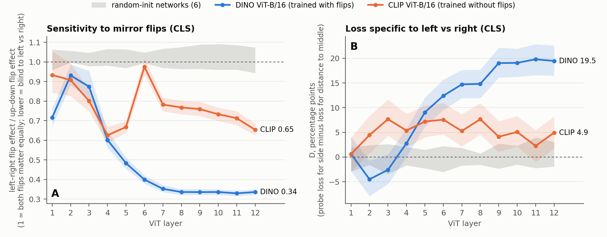

# Mirror Invariance and Attribute Binding in Vision Transformers

**Status:** work in progress (independent research, since September 2026; dated log in [`LOG.md`](LOG.md)). A preprint for arXiv (cs.CV) is in preparation.
**Author:** Yernazar Gabdrakhman

## Question

To understand a scene, a vision model has to know *which feature belongs to which object*. The images "red square + blue circle" and "blue square + red circle" contain the same set of features and differ only in this **binding**. A model that keeps only a "bag of features" cannot tell them apart.

This project asks whether Vision Transformers (ViTs) store attribute binding, in which layers it is kept or lost, and what makes a model lose it.

## Method

- **Stimuli.** 2,000 synthetic 224×224 scenes with 2–4 simple shapes in six colors of equal brightness (`generate_v2.py`). Every scene has two **twins** (same shape and size, different colors) and three versions:
  - `S`: the original scene;
  - `Sp`: the twins swap colors, so the bag of features is identical down to the pixel and only binding changes;
  - `Sr`: a control in which the twins are recolored with two new colors.
- **Probes.** At every layer, a linear probe (logistic regression; ridge as a robustness check; cross-validated by scene) predicts the color of the *left* or *upper* twin. It reads from the CLS token, from untouched objects, or from background patches at least 3 patches away from both twins. A bag-of-features representation scores **exactly 50%** by construction.
- **Controls.** Layer 0 (must be exactly 50%), three randomly initialized networks per architecture, and a positive control (the twin's own patches, ~100%). All intervals are 95% bootstrap CIs over scenes.
- **Mirror test.** For scenes made only of mirror-symmetric shapes, we measure how much a left–right flip changes the representation compared with an up–down flip (`flip_test.py`). A value of 1 means both flips matter equally; lower means the model is blind to left vs. right.
- **Rules and predictions written down before each run.** For each experiment, the decision rule (and my own prediction) was recorded in the project notebook before the run; they are not externally timestamped. English versions and the scored predictions (6 hits out of 18 resolved so far) are in [`PREDICTIONS_AND_RULES.md`](PREDICTIONS_AND_RULES.md). Since 6 November 2026, the design, rule and prediction are also registered on OSF before the run ([osf.io/us5zv](https://osf.io/us5zv), [osf.io/6uves](https://osf.io/6uves), [osf.io/23wjy](https://osf.io/23wjy) and [osf.io/j2g74](https://osf.io/j2g74), under embargo until the preprint, at the latest 31 March 2027).

Models: DINO ViT-B/16, OpenAI CLIP ViT-B/16, MAE ViT-H/14, I-JEPA ViT-H/14 (target encoder).

## Results so far

| | DINO | CLIP | MAE | I-JEPA |
|---|---|---|---|---|
| Mirror sensitivity, last layer (CLS / patch mean; random ≈ 1) | 0.34 / 0.28 | 0.65 / 0.61 | 0.67 / 0.63 | — / 0.40 |
| Binding gap "upper − left", **far background**, last layer (pp) | 18.6 | 9.0 | 10.1 | 11.4 |
| Binding gap "upper − left", **CLS**, last layer (pp) | 20.4 | 9.3 | 6.8 | no CLS |

Last layer: L12 for DINO and CLIP (ViT-B/16), L32 for MAE and I-JEPA (ViT-H/14). Every number names the token group it comes from; the source CSVs and logs are in [`results/`](results/).

1. **Binding is learned and readable.** In DINO, the left twin's color is decoded from the CLS token with up to 78.2% accuracy (layer 3); the upper twin's with 83.9% at layer 12. From the far background (the readout used by all later pre-registered rules): 73.0% (layer 3) and 83.5% (layer 12). Random networks stay at 49–52%.
2. **Left–right binding fades where mirror invariance appears.** From layer 4 on, DINO's left–right binding drops (to 63.5% at layer 12 from CLS; 64.9% from the far background) while up–down binding stays. In the same layers DINO becomes almost blind to left–right mirroring (0.34 [0.32, 0.35]).
3. **DINO "folds" the image.** It loses *which side* an object is on but keeps *how far* it is from the vertical midline (rule fixed before the run; D = 19.5 [16.5, 22.6] for DINO vs. 4.9 [1.7, 8.2] for CLIP). See Figure 1.
4. **In these two models, flip augmentation is neither necessary nor sufficient for mirror blindness.** In a comparison with a rule fixed before the run (same size and training data), I-JEPA, which never saw flipped images, is *more* mirror-blind than MAE, which did: Δ = −0.22 [−0.30, −0.15] (patch mean, last layer). MAE and I-JEPA also differ in their training objective, so this is not a clean test of a single factor; the objective and the statistics of natural images remain candidates.
5. **The binding gap does not separate MAE from I-JEPA.** On the far background at the last layer the gap is 10.1 [8.5, 11.6] pp for MAE and 11.4 [9.9, 13.0] pp for I-JEPA; Δ = 1.3 [−0.6, 3.2] pp. By a rule fixed before the run the verdict is "does not discriminate": the interval includes 0, so the data neither show nor exclude a difference. I-JEPA is much more mirror-blind than MAE (0.40 vs. 0.63), yet does not clearly lose more left–right binding. So "more mirror-blind → larger binding gap" is not confirmed in this pair; the link currently rests on DINO and CLIP only. Per-layer differences are uneven (see `results/probe_big_compare_log.txt`).

6. **First causal test: in DINO, both attention and MLP in blocks 4–12 are needed for the loss of left–right binding.** Registered on OSF before the run ([osf.io/us5zv](https://osf.io/us5zv)). The output of all attention (or all MLP) sublayers in blocks 4–12 is replaced by its mean over the images, separately for each token position (mean-ablation), and the probes are retrained at layer 12 (far background, 97.5% CIs). With attention ablated, "left" rises by +4.5 [+2.7, +6.3] pp while "upper" falls by 8.2 [6.8, 9.8] pp; with the MLP ablated, "left" rises by +8.5 [+6.9, +10.1] pp and "upper" by +3.1 [+1.8, +4.4] pp. By the rule both parts "erase" → verdict "C". No single sublayer does so on its own (18 sublayers, 99.72% CIs), so the loss is spread across blocks. *Not part of the rule:* ablating attention also restores mirror sensitivity (CLS 0.34 → 0.82), while ablating the MLP restores "left" but leaves the model almost as mirror-blind (0.40). So the loss of left–right binding can be separated from mirror blindness: mirror blindness is not the only cause. Caveats: one model; mean-ablation puts the network outside its training distribution; it shows that a part is needed, not how it erases; ablating attention in nine blocks also cuts each token off from new information from other tokens after layer 3, which is why "upper" serves as a control.

7. **The same causal test on CLIP: only attention is needed for the loss of left–right binding.** Registered on OSF before the run ([osf.io/6uves](https://osf.io/6uves)). Same rule as finding 6; blocks chosen by the same principle (from the block after the peak of "left" to the last): in CLIP, "left" on the far background peaks at layer 6, so blocks 7–12 are ablated. With attention ablated, "left" rises by +3.2 [+1.5, +4.9] pp while "upper" falls by 5.0 [3.3, 6.7] pp → attention "erases". With the MLP ablated, "left" rises by +10.0 [+8.3, +11.7] pp but "upper" rises just as much (+10.5 [+9.0, +12.1]); the difference is −0.5 [−2.8, +1.7] pp → the MLP is "not involved" (its effect is general, not horizontal). Verdict "A". No single sublayer erases on its own. *Not part of the rule:* as in DINO, ablating attention also removes mirror blindness (CLS 0.65 → 1.20), ablating the MLP changes it little (0.79). Across the two models: late-block attention is needed for the loss of left–right binding in both; the role of the MLP differs (needed in DINO, not specifically in CLIP). Caveats: one model per test; CLIP has 6 ablated blocks, DINO 9; mean-ablation is out of distribution; necessity, not mechanism.

8. **Where the binding information sits across DINO's layers: it leaves the twins' tokens around layer 6.** Registered on OSF before the run ([osf.io/23wjy](https://osf.io/23wjy)). A "left" probe on the far background at layer 12 is trained once and kept fixed. In the run on one image of a pair, the tokens of both twins are replaced at layer L by their values from the other image (where the twins have swapped colors), and the network continues. T(L) is the share of runs in which the fixed probe then follows the other image. T stays high in early layers (98.0% at L01, 81.2% at L03) and first falls below 50% at **L06** (43.8% [41.1, 46.7]); at L11 it is 11.9% [10.2, 13.7]. Replacing the same number of other tokens changes almost nothing (≤ 6.9% on every layer), so the effect is specific to the twins. So up to about layer 5 the "left" answer at layer 12 depends mainly on the twins' own tokens; from layer 6 on, most of what it depends on is already in other tokens. *Reference:* in random networks T also falls (below 50% already at L02–L03), because attention mixes tokens even without training; the trained network keeps the information on the twins longer (L03: 81% vs. 45–49%), and by L11 both are alike (≈ 11–12%). Caveats: one model; whole tokens are replaced (color, shape and position at once), and the result is read by one probe, so this shows where the information that this readout depends on sits, not which subspace carries it or how the network uses it. One code check printed a warning caused by float16 storage (2 of 1420 runs; explained in [`PREDICTIONS_AND_RULES.md`](PREDICTIONS_AND_RULES.md)).

9. **How many directions carry what the "left" probe reads? Distributed alignment search (DAS) on DINO: two directions in the twins' tokens; no compact code shown in the background.** Registered on OSF before the run ([osf.io/j2g74](https://osf.io/j2g74)). As in finding 8, a "left" probe (far background, L12) is fitted once, here on scene folds 1–4, and then kept fixed. Instead of whole tokens, only the projection onto k learned orthonormal directions is replaced by its value from the other image of the pair (k = 1, 2, 4, …, 32). The directions are trained on the same folds with the network and the probe frozen. The interchange-intervention accuracy (IIA) is the share of held-out runs (fold 0, 400 scenes) in which the probe then follows the source image; P is the IIA when the whole region is replaced. Two regions: (A) the twins' tokens at L03; (B) far-background tokens at L08. Rule fixed before any code was written: the smallest k with IIA ≥ 0.5·P and IIA − (best of three random networks) ≥ 0.3·P; if there is none, "does not compress to 32 directions".

   - **(A)** P = 79.3% [74.1, 84.4]. IIA for k = 1, 2, 4, 8, 16, 32: 38.5 / 54.8 / 71.1 / 85.9 / 87.8 / 90.0%; best random network: 17.8 / 29.3 / 47.0 / 53.0 / 59.8 / 62.1%. **Smallest k = 2**, with a small margin: the second condition is met by 1.7 pp at k = 2 and by 0.4 pp at k = 4.
   - **(B)** P = 60.0% [53.3, 66.7]. IIA: 33.3 / 52.2 / 67.0 / 73.3 / 74.1 / 75.9%; best random network: 26.2 / 35.6 / 55.2 / 62.1 / 62.6 / 75.3%. The difference is 7.1 / 16.6 / 11.9 / 11.3 / 11.4 / 0.6 pp, and the rule requires 18.0 pp. **No k qualifies: "does not compress to 32 directions".**

   *Interpretation.* (A) locates the twins' color in their own tokens at L03: a few directions suffice, and DINO is 21–33 pp above the best random network at every k. This is not binding as such (a caveat written down before the run). (B) is the test of binding outside the twins. Here DINO is 11–17 pp above the best random network at k = 2–16, which is below the threshold set in advance, and at k = 32 a random network reaches the same level (75.3% vs. 75.9%). The test therefore cannot separate a learned, compact binding code from what DAS finds in any network, including an untrained one. A compact code in the background is **not shown**; this is not evidence that none exists.

   *Not part of the rule.* With shuffled target labels DAS still reaches 31–42% in (A) and 14–41% in (B), so IIA should be read against this floor rather than against zero. DAS exceeds P in both regions (e.g. 75.9% vs. 60.0% in (B)), so P is a reference level, not a ceiling; in the random networks, replacing the whole background is itself more effective than in DINO (72–80% vs. 60%). Restricting the learned directions to the subspace where the region's activations actually vary (99% of the variance) lowers IIA by 3–6 pp in (A) but by 12–22 pp in (B): in (B) part of the effect runs through directions that are nearly constant in normal inputs, the situation Makelov et al. warn about. The (B) and (A) subspaces barely overlap (1.6–5.1%; chance level 0.1–4.2%).

   *Caveats.* One model, one data split and one DAS seed (in a pilot, the SD across three seeds was 1.3 pp for (B) at k = 32). In 15 of 60 training runs the loss was still decreasing at the end, including DINO (A) at k = 1–2 and (B) at k = 4–32, so some DINO values may be underestimated. DAS can find directions that act through pathways the unmodified network does not use, and what is measured is the reading of one linear probe, not the model's behavior. Predictions: 1 hit out of 4 (the range for k = 1 in (A)).

Findings 1–5 are correlations across a few models on synthetic scenes; findings 6–9 are causal tests on DINO and CLIP.



*Figure 1. (A) Left–right vs. up–down mirror sensitivity of the CLS token across layers. (B) D: information about the side (left vs. right) lost beyond a general weakening of horizontal position. Gray: random-initialized networks.*

## How to run

```bash
python -m venv venv && source venv/bin/activate
pip install -r requirements.txt

python generate_v2.py                                  # scenes -> data_v2/
python extract.py --data data_v2 --out acts_v2         # DINO activations (~22 GB)
python extract.py --data data_v2 --out acts_v2_rand0 --random-init 0   # null model (also seeds 1, 2)
python swap_v2.py                                      # swap vs. recolor
python null_compare.py                                 # DINO vs. random networks
python probe_v2.py                                     # binding probe, "left" twin
python probe_v2.py --query upper --tag upper           # binding probe, "upper" twin
python flip_test.py                                    # mirror test (also --model clip | mae | ijepa)
python flip_compare.py                                 # MAE vs. I-JEPA rule
python probe_fold.py                                   # "folding" experiment
python probe_big.py --model mae                        # binding probe on ViT-H (also --model ijepa)
python probe_big_compare.py                            # MAE vs. I-JEPA binding rule
python ablate_blocks.py                                # causal test: mean-ablation in DINO blocks 4–12 (~1 h)
python ablate_clip.py                                  # the same test on CLIP, blocks 7–12 (~1 h)
python patch_twins.py                                  # twin-token patching across DINO layers (~1 h)
python das_binding.py                                  # distributed alignment search on DINO (~5.5 h on a Mac GPU via MPS)
python figure1.py                                      # Figure 1
```

Each script's header (in Russian) explains what it tests, the decision rule and its built-in checks; English versions of the rules are in [`PREDICTIONS_AND_RULES.md`](PREDICTIONS_AND_RULES.md). Activations and generated images are not stored in the repository; the scripts recreate them. The original outputs (small CSVs and logs) are in [`results/`](results/).

## Files

| Script | What it does |
|---|---|
| `generate.py`, `generate_v2.py` | Synthetic scenes (v1; v2 with twins and S / Sp / Sr) |
| `extract.py` | Layer-wise activations (DINO, CLIP; trained or random weights) |
| `probe_sanity.py`, `swap_look.py` | Pipeline checks and a first look (v1) |
| `swap_v2.py`, `null_compare.py` | Swap vs. recolor; comparison with random networks |
| `probe_v2.py`, `probe_breakdown.py` | Binding probes and what they depend on |
| `flip_test.py`, `flip_compare.py` | Mirror test; MAE vs. I-JEPA |
| `probe_fold.py`, `probe_fold_strata.py`, `probe_fold_compare.py` | "Folding" experiment and analyses |
| `probe_big.py`, `probe_big_compare.py` | Binding probe on ViT-H/14 (MAE, I-JEPA) with cached group means |
| `ablate_blocks.py` | Causal test: mean-ablation of attention / MLP in DINO blocks 4–12 (OSF us5zv) |
| `ablate_clip.py` | The same causal test on CLIP, blocks 7–12 (OSF 6uves) |
| `patch_twins.py` | Twin-token patching across DINO layers with a fixed probe (OSF 23wjy) |
| `das_binding.py` | Distributed alignment search on DINO: how many directions carry what the "left" probe reads (OSF j2g74) |
| `clip_check.py` | Checks that CLIP weights and preprocessing are loaded correctly |
| `figure1.py` | Figure 1 |
